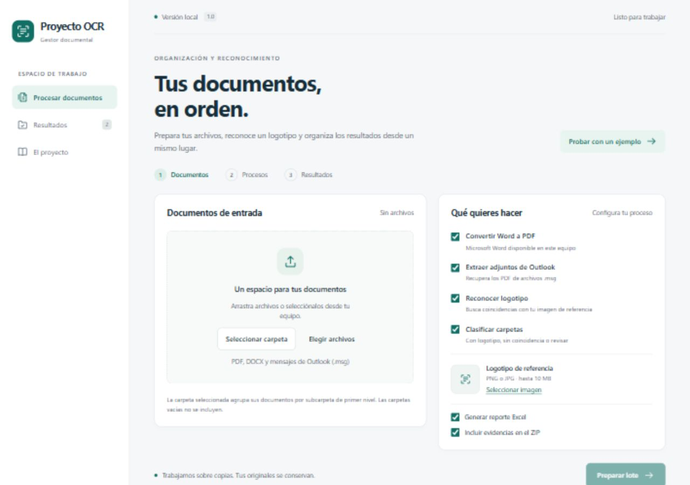

# Proyecto OCR

Una aplicación web local para preparar documentos, reconocer logotipos en PDF y revisar una clasificación sugerida. Recupera el flujo del proyecto original de Python mediante una interfaz en español.



**Python · FastAPI · OpenCV · Microsoft Word · HTML/CSS/JavaScript**

## Qué puedes hacer

- Convertir documentos Word a PDF y recuperar adjuntos PDF de Outlook.
- Comparar imágenes de documentos con un logotipo de referencia.
- Revisar la clasificación, las evidencias y las incidencias de cada lote.
- Descargar un reporte Excel y un ZIP con los resultados.
- Probar el flujo con documentos ficticios incluidos en la demostración.

El nombre conserva el del proyecto original. Esta versión reconoce logotipos; todavía no extrae texto mediante OCR ni verifica firmas. La aplicación se ejecuta en el computador de quien la instala: el repositorio público comparte el código, no aloja un servicio web.

## Instalar en Windows

1. Instala **Python 3.14** con el lanzador `py`. Para convertir DOCX también necesitas **Microsoft Word de escritorio**.
2. Descarga el repositorio con **Code → Download ZIP** y extrae la carpeta, o clónalo:

   ```powershell
   git clone https://github.com/Eve1254/Proyecto-OCR.git
   cd Proyecto-OCR
   ```

3. Ejecuta **Preparar OCR.cmd**. La primera instalación requiere conexión a Internet para descargar las dependencias.
4. Ejecuta **Iniciar OCR.cmd** y pulsa **Probar con un ejemplo**.

## Abrir la aplicación

1. Abre **Iniciar OCR.cmd** con doble clic.
2. Se abrirá el navegador, normalmente en `http://127.0.0.1:8765`.
3. Conserva abierta la ventana de Proyecto OCR mientras lo usas. Para cerrar el servidor, pulsa **Ctrl+C** en esa ventana.

Si ya hay una instancia abierta, el lanzador vuelve a abrir su dirección. Si otro programa usa el puerto inicial, se elige uno libre entre los 20 siguientes; la dirección aparece en la ventana de inicio.

Después de instalar, el procesamiento funciona localmente, sin servicios externos. No es necesario volver a preparar el entorno cada vez que abres la aplicación.

## Primera prueba

1. Pulsa **Probar con un ejemplo**.
2. Revisa el lote de tres PDF ficticios y pulsa **Iniciar procesamiento**.
3. La demo debe mostrar un grupo con logotipo, uno sin coincidencia y uno para revisar porque su PDF no contiene imágenes.
4. Abre **Ver evidencia** y descarga **Reporte Excel** y **Resultados ZIP**.

Los datos de demostración se procesan realmente. No son resultados predeterminados ni documentos empresariales.

## Procesar tus documentos

- Selecciona una carpeta o varios archivos PDF, DOCX y MSG. También puedes arrastrar archivos individuales.
- Elige los procesos que necesitas y, para reconocimiento, una imagen PNG o JPG nítida del logotipo.
- Pulsa **Preparar lote**. Comprueba los grupos y las opciones antes de iniciar el procesamiento.
- Consulta el avance en **Resultados**. Puedes solicitar cancelación entre archivos. Word tiene un tiempo máximo independiente de 90 segundos por documento.
- Descarga el Excel, que contiene Resumen, Carpetas, Archivos e Incidencias, y el ZIP con las copias originales, los derivados y las evidencias que hayas elegido incluir.

Límites: 500 archivos de entrada, 50 MB por archivo, 500 MB por trabajo (incluidos derivados) y 10 MB para la referencia. Los valores están en `ocr_app/config.py`. El reconocimiento admite hasta 300 páginas y 1.500 imágenes por PDF; imágenes de hasta 25 millones de píxeles. Los límites evitan trabajos demasiado grandes en el piloto local.

## Agrupación y resultados

La carpeta seleccionada es el contenedor del lote. Cada subcarpeta de primer nivel es un grupo; todos sus documentos y subcarpetas se evalúan juntos. Los archivos directamente en la raíz, o seleccionados individualmente, forman el grupo **Archivos sueltos**. El navegador no transmite las carpetas vacías.

Los adjuntos de un MSG y los PDF convertidos heredan el grupo original. No se deduce un grupo distinto por encontrar una carpeta llamada `Convenio`.

- **Con logotipo:** hay coincidencia y todos los documentos compatibles del grupo se pudieron evaluar.
- **Sin coincidencia:** se evaluaron sus imágenes y no hubo coincidencia suficiente.
- **Revisar:** hay documentos sin evaluar, dañados, protegidos, sin imágenes utilizables o cuya preparación se desactivó.

Una clasificación es una sugerencia, no una certificación de tipo de convenio. El algoritmo compara características visuales SIFT de las imágenes incrustadas en PDF; conserva el criterio inicial de más de diez correspondencias filtradas. No hay una medición de precisión sobre documentos empresariales ni una probabilidad de certeza. Puede haber falsos positivos o negativos. No extrae texto ni verifica firmas; los logotipos vectoriales y ciertos escaneos pueden requerir revisión manual.

## Archivos y privacidad local

Se procesan **copias**, nunca se mueven ni borran los originales de entrada. Los trabajos y resultados permanecen en `data/jobs/`, excluido de Git. Borrar un trabajo desde la aplicación elimina únicamente esas copias y resultados y requiere confirmación.

La aplicación escucha exclusivamente en `127.0.0.1`. No tiene cuentas de usuario ni está preparada para exponerse directamente a Internet o a una red compartida. La futura versión multiusuario requiere autenticación, separación de archivos y otro diseño de ejecución. La automatización de Word utilizada aquí pertenece a la sesión local de Windows; no debe trasladarse sin cambios a un servidor.

Las carpetas numeradas del repositorio conservan los scripts originales como referencia histórica. El código nuevo, ubicado en `ocr_app/`, adapta su lógica en servicios separados, elimina las rutas fijas y añade validaciones, interfaz y pruebas. Para usar la versión actual ejecuta los lanzadores de la raíz; los scripts históricos contienen rutas fijas y operaciones directas sobre archivos.

## El proyecto como experiencia

La herramienta nació de un proceso de automatización documental y evolucionó hacia una aplicación con interfaz, procesamiento por lotes y revisión de resultados. La versión web se desarrolló con asistencia de IA sobre el proyecto original.

- [Historia, aprendizajes y texto para portafolio](docs/experiencia.md).
- [Validación funcional y pruebas realizadas](docs/validacion.md).

Las siguientes etapas son validar documentos representativos, medir el reconocimiento y preparar acceso compartido con autenticación y separación de archivos por usuario.

## Desarrollo y pruebas

```powershell
.\.venv\Scripts\python.exe -m pip install -r requirements-dev.txt
.\.venv\Scripts\python.exe -m pytest -q
node --check ocr_app/static/app.js
```

Para comprobar también Word instalado en Windows:

```powershell
$env:OCR_TEST_WORD='1'
.\.venv\Scripts\python.exe -m pytest tests/test_word.py -q
Remove-Item Env:OCR_TEST_WORD
```

Las pruebas usan documentos ficticios y directorios temporales. La prueba opcional de Word abre y cierra una instancia propia; no se conecta a una instancia que tenga abierta la persona usuaria. La extracción MSG se comprueba con un archivo MSG sintético real y con adjuntos defectuosos y repetidos; todavía conviene validar archivos representativos de tu flujo real.

Inicio sin abrir automáticamente el navegador: `python run.py --no-browser --port 8765`. Para separar datos durante desarrollo define `OCR_DATA_DIR` con una carpeta de trabajos. No arranques varias aplicaciones distintas sobre la misma carpeta mediante comandos alternativos al lanzador.

## Estructura

- `ocr_app/app.py`: API local, carga y descargas.
- `storage.py`, `runtime.py`, `jobs.py`: persistencia, exclusión de instancias y control de ejecución.
- `processing.py`, `recognition.py`, `word_worker.py`: flujo documental y reconocimiento.
- `reports.py`, `demo.py`: Excel y datos ficticios de demostración.
- `ocr_app/static/`: interfaz sin herramientas de compilación ni dependencias de CDN.
- `tests/`: regresiones de entrada, procesamiento, API y Word.
- `docs/experiencia.md`: material para explicar el proyecto como experiencia.

Las bibliotecas conservan sus licencias originales; revisa sus condiciones antes de distribuir o comercializar el proyecto. En particular, consulta la licencia de PyMuPDF/MuPDF al preparar una publicación.
