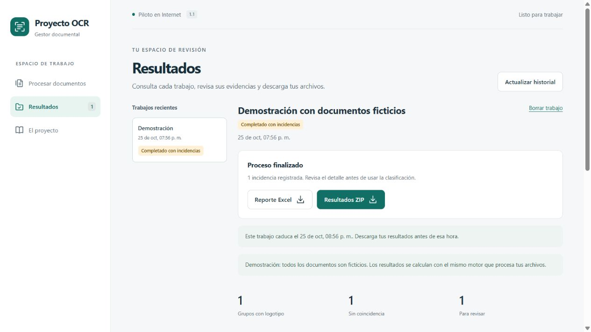

# Validación del piloto público

Fecha: 25 de octubre de 2026.

La versión pública añade sesiones anónimas por navegador, caducidad de trabajos, procesamiento acotado y conversión DOCX con LibreOffice. La aplicación local de Windows conserva Microsoft Word y sus límites anteriores.

## Pruebas reproducibles

- **Windows: 65 pruebas aprobadas y 1 omitida**, con `OCR_TEST_WORD=1`. Se comprobó Word instalado; la omitida necesita LibreOffice en Linux.
- **Contenedor Linux: 64 pruebas aprobadas y 2 omitidas**. Se ejecutó la conversión real con LibreOffice; se omitieron las dos pruebas específicas de Word en Windows.
- **Servidor HTTP con un límite de 512 MiB:** demostración completa, conversión DOCX real, descarga ZIP, descarga Excel y separación de visitantes. Se ejecutó la imagen de producción con `docker run --memory=512m --cpus=1`.
- Sintaxis de JavaScript comprobada con `node --check ocr_app/static/app.js`.

Evidencia: [ejecución de GitHub Actions de la revisión 58b2032](https://github.com/Eve1254/Proyecto-OCR/actions/runs/40251292101). Esta revisión se integró mediante la [PR #1](https://github.com/Eve1254/Proyecto-OCR/pull/1), con el commit `d9dd0cba0f5924bdf7264b9f9cee1911e35d78f2`.

Las pruebas cubren acceso de otro visitante, cookie alterada, origen y host ajenos, cuotas, archivos demasiado grandes, recepción lenta, caducidad durante descargas, cancelación, límites del trabajador y rechazo de DOCX inseguros. Usan documentos ficticios y carpetas temporales.

## Despliegue

Servicio: [Proyecto OCR](https://proyecto-ocr-fcml.onrender.com/), Render Free, una instancia, región Oregon. Los despliegues automáticos del servicio están desactivados. El contenedor ejecuta las pruebas de Linux antes de completar su construcción.

Render confirmó el despliegue activo de `d9dd0cb`. Su propia compilación repitió las 64 pruebas de Linux con éxito (2 omitidas por ser específicas de Windows).

Se verificó directamente sobre el enlace HTTPS:

- Estado público y conversión LibreOffice disponible.
- Cookie de sesión `__Host-ocr_session`, con `Secure`, `HttpOnly` y `SameSite=Strict`, y cabecera HSTS.
- Demo con un grupo con logotipo, otro sin coincidencia y otro que requiere revisión.
- Carga y conversión de un DOCX ficticio en el servidor.
- Descargas válidas de ZIP y Excel.
- Segunda sesión con historial vacío y respuesta 404 al intentar consultar o descargar trabajos de la primera.

También se recorrió la demostración desde el navegador, incluida la espera en cola mientras otro visitante procesaba un lote, la visualización de la evidencia y la descarga del reporte Excel.

## Alcance

Estas comprobaciones validan el funcionamiento del piloto y sus regresiones conocidas. No constituyen una auditoría de seguridad independiente ni una medición de precisión sobre documentos empresariales. El reconocimiento compara logotipos en imágenes incrustadas; no extrae texto ni verifica firmas.

Los documentos caducan una hora después de crear el lote; una suspensión, reinicio o despliegue puede eliminarlos antes. El servicio gratuito puede tardar aproximadamente un minuto en abrir después de estar inactivo. Consulta los [límites del piloto](internet.md) y las [condiciones de Render Free](https://render.com/docs/free).
